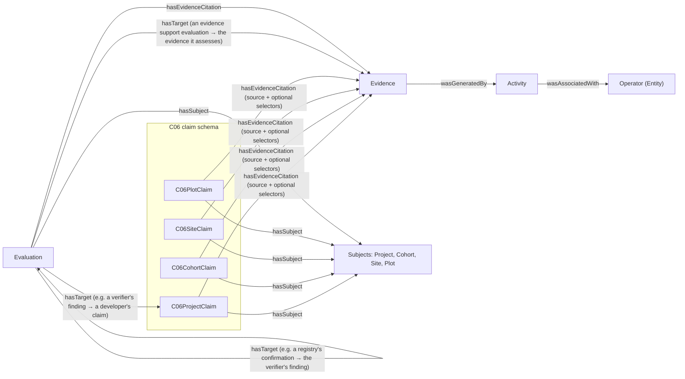
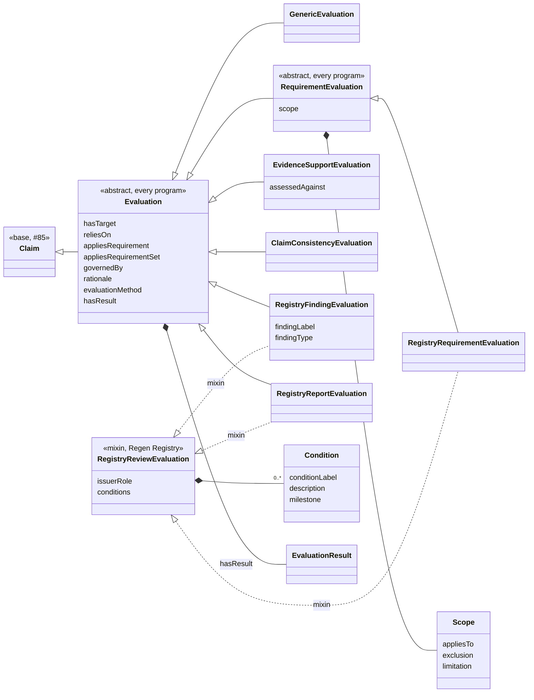

# Evaluation, Evidence and the C06 claims

This document describes the schemas added for
[#73 (WP1-06)](https://github.com/regen-network/regen-data-standards/issues/73): the base
[`Evaluation`](../schema/src/Evaluation.yaml) with its program-agnostic kinds, the Regen Registry
review kinds in [`RegistryReviewEvaluation`](../schema/src/RegistryReviewEvaluation.yaml), the full
[`Evidence`](../schema/src/Evidence.yaml) with the [`Activity`](../schema/src/Activity.yaml) that
generated it, the shared terms added to
[`ClaimVocabulary`](../schema/src/ClaimVocabulary.yaml), and the C06 claim schema
[`C06Claim`](../schema/src/C06Claim.yaml). It builds on the base Claim described in
[`docs/claim-base.md`](claim-base.md).

The design was derived from the records of one real registration and validation review, the WP8-01
workflow ([claims#49](https://github.com/regen-network/claims/issues/49)). That evidence is project
data and is kept internally; this document and the examples use synthetic values only.

## How the types relate



| Type | Produced by | Consumed by | Reuse decision |
|---|---|---|---|
| C06 claims | The project developer, as claimant, from its project plan and datasets | Registry review, rule evaluation (WP5), the verifier, auditors, graph queries (WP4), publication (WP7) | New `C06Claim` schema; classes `is_a Claim` |
| C06 subjects | Defined once in the C06 claim schema. A subject's IRI is minted once and never built from a field a claim can correct, such as `siteKey`, so it stays the same when those fields are corrected; who mints it is for [claims#55](https://github.com/regen-network/claims/issues/55) | Every claim and evaluation about them | `is_a ClaimSubject` |
| `Evaluation` and `RequirementEvaluation` (abstract), `GenericEvaluation`, `EvidenceSupportEvaluation`, `ClaimConsistencyEvaluation` | Any issuer of a judgment | Review workflows (WP5), verifiers, auditors, Ledger attestation (WP6-01), external mappings (WP7) | `Attestation.yaml` rewritten: `is_a Claim`, program-agnostic |
| `RegistryRequirementEvaluation`, `RegistryFindingEvaluation`, `RegistryReportEvaluation` | The Registry Agent, an independent verifier (VVB), the Credit Class Admin | The same | New module; each declares the `RegistryReviewEvaluation` mixin; `RegistryRequirementEvaluation is_a RequirementEvaluation`, the others `is_a Evaluation` |
| `Evidence` | Whoever cites a source | Reviewers, the resolver (WP6-04), auditors | The #85 skeleton, extended; no subclasses |
| `Activity` (abstract), `GenericActivity`, `Capture` | Whoever cites the evidence it generated; for a `Capture`, the sensor or tool that fetched a source | Reviewers checking when and by whom evidence was produced, and which capture of a source is the latest | New module; `ProvActivity` mixin; records of their own, referenced by IRI |

A project developer's response to a finding is a Claim by the developer (usually a revised C06
claim with new evidence), not an evaluation.

`hasTarget` names the exact resources an evaluation directly examines or assesses in reaching its
conclusion. When a resource can change, the target is the particular version or snapshot assessed: an
exact claim or evaluation version, an `Evidence` record, or a snapshot (a fixed set of claim
versions, identified by its SnapshotIRI, [claims#56](https://github.com/regen-network/claims/issues/56)),
for example when a judgment covers a whole submission. It is distinct from the focal subject and
from the criteria applied: a land-tenure evaluation may have a project as its `hasSubject`, directly
assess particular tenure claims or `Evidence` records through `hasTarget`, and name the governing
requirement through `appliesRequirement`. The base slot accepts any resource; a kind of evaluation
may require it or restrict it, as [`EvidenceSupportEvaluation`](#evidencesupportevaluation) does to `Evidence`
records. `hasTarget` never names a logical label: a finding that runs over several review rounds is a series of dated evaluations,
grouped by the issuer's `findingLabel`.

## Modules

| Module | Change | Imports |
|---|---|---|
| `Claim.yaml` | `hasClaimType` removed (see [Field migrations](#field-migrations)). | as before |
| `ClaimVocabulary.yaml` | `hasEvidence` is replaced by `hasEvidenceCitation` on the base Claim: citations that name `Evidence` records by IRI, instead of inlining them, with optional selectors. Adds `hasTarget`, `reliesOn`, `appliesRequirement`, `addressesRequirement`, `appliesRequirementSet`, `governedBy`, `evaluationMethod`, `evaluationMethodDescription` and the `EvaluationMethodType` enum. `wasAssociatedWith` moves to `Activity.yaml`, which it imports, so importing `ClaimVocabulary` still provides it. | adds `Activity` |
| `core.yaml` | `inLanguage` moves here from `ClaimVocabulary.yaml`, unchanged, so that `Evidence`, which `ClaimVocabulary` imports, can use it. | as before |
| `Evidence.yaml` | Adds the source hash, language, resolver, DCMI type, format, licence reference, issue date and generating activity (`wasGeneratedBy`), the integrity-outcome terms, and the citation profile (`EvidenceCitation` with Web Annotation selectors). | adds `Activity` |
| `Activity.yaml` | New: the abstract `Activity` (IRI, `name`, `description`, `wasAssociatedWith`), `GenericActivity` (`startDate`, `endDate`) and `Capture` (`used`, `startedAtTime`, `endedAtTime`). `startDate` and `endDate` move here from `C06Claim.yaml`. It is a separate module because `Evidence` needs it and `ClaimVocabulary` imports `Evidence`. | `Entity`, `ProvAlignment` |
| `Evaluation.yaml` | Replaces `Attestation.yaml`: the abstract `Evaluation is_a Claim`, `GenericEvaluation`, `Scope`, and the program-agnostic kinds: the abstract `RequirementEvaluation`, `EvidenceSupportEvaluation` and `ClaimConsistencyEvaluation`, with their verdict enums. | `Claim`, `ClaimVocabulary` |
| `RegistryReviewEvaluation.yaml` | New: the `RegistryReviewEvaluation` mixin (issuer role, conditions, required method), the kinds that declare it, `RegistryRequirementEvaluation` (`is_a RequirementEvaluation`), `RegistryFindingEvaluation` and `RegistryReportEvaluation`, `Condition`, and the review enums. | `Evaluation` |
| `C06Claim.yaml` | New, version 0.1.0: four subject classes, five claim classes. | `Claim`, `ClaimSubject`, `ClaimVocabulary`, `taxonomy` |

No `Requirement` or `RequirementSet` class exists or is added: requirements and their sets, whose format WP5-01
([claims#30](https://github.com/regen-network/claims/issues/30)) defines, and claims and evaluations
reference them by IRI. Inheritance follows #85: domain claims are `is_a Claim`, shared
terms are imported from `ClaimVocabulary`.

## Evaluation

An evaluation is a Claim that records an assessment made by an agent about one focal subject. Its
`claimStatement` states the assessment. As a Claim, it identifies the agent responsible for it
(`assertedBy`) and when it was made (`assertedAt`). Depending on the kind of evaluation, it may also
identify the resources it directly assessed (`hasTarget`), the criteria it applied
(`appliesRequirement`, `appliesRequirementSet`) and the documents it is made under (`governedBy`), the evidence it relied on (`hasEvidenceCitation`), the
method it used and its result. It holds nothing that changes after it is made: a later assessment is
a new evaluation, and a correction is a new version linked through `wasRevisionOf`.

The focal subject (`hasSubject`), such as a project, plot, organization, activity or dataset, is
stated even when the evaluation directly assesses a claim about it, because some assessments, such
as whether a project meets a requirement, have no single target claim.

It is called an evaluation, not an attestation, because it records the judgment itself. Attestation
is left for an agent binding itself to exact content, which the data module's `MsgAttest` does on
Regen Ledger: an attestor signs a record's Graph IRI. Any Claim or Evaluation can be attested that
way; what to attest and who signs is [WP6-01 (claims#36)](https://github.com/regen-network/claims/issues/36).

It comes in two layers: what every program's judgments share, with the kinds of judgment that are
not specific to a program, and one program's review kinds. `Evaluation` is abstract, like `Claim`:
its generated shape is open, so it checks the base content of every kind, including kinds another
program defines outside this schema, and lets a kind add fields. A judgment made under no program's
vocabulary is a `GenericEvaluation`, whose shape is closed, as `GenericClaim` is for claims.

`GenericClaim` is a claim that uses only the base fields, such as a written statement with its
claimants, time, subject and evidence; `GenericEvaluation` is an evaluation that uses only the
shared Evaluation fields, with a generic result if any. Each means no more than its base. They exist as
their own classes so that such records are validated with a closed shape: a generated shape is open
or closed for a class and all its subclasses alike, so an open base cannot also close its own direct
instances. SHACL could express that with a hand-written SPARQL-based target, which `gen-shacl` does
not generate. Once a schema version is published they are entry points like any
other, and changing them means a new version.

The open bases permit extension; they promise nothing more. Another program may publish a subclass
of `Evaluation` or `Claim` with fields of its own, under its own namespace, and the base shapes
accept it. That does not by itself mean Regen registers the profile, supports it in its tooling,
admits its instances into a managed service, or endorses it: each of those is a separate decision,
not made by this schema.



There is no evaluation type field. Like `hasClaimType`, a single list of kinds of judgment would not
fit every program. Each kind of judgment is a subclass, because the kinds answer different questions:
whether a requirement is satisfied, whether a finding is resolved, what a verifier's opinion of the
project is, what evidence shows.

**Results.** An evaluation's conclusion is a result node (`hasResult`), whose type depends on the
kind, in the style of the W3C Evaluation and Report Language (EARL): attribution, time, subject,
targets, method and rationale stay on the evaluation, and the result holds the principal outcome with
any qualifiers of it ([discussion](https://github.com/regen-network/regen-data-standards/pull/90#discussion_r4255076742)).

| Kind | Result | Principal outcome (`outcome`) | Qualifiers |
|---|---|---|---|
| `GenericEvaluation` | `GenericEvaluationResult` (optional) | any IRI | — |
| `RequirementEvaluation` | `RequirementAssessmentResult` | `SATISFIED`, `NOT_SATISFIED`, `UNDETERMINED` | `applicability` (required) |
| `EvidenceSupportEvaluation` | `EvidenceSupportResult` | `SUPPORTS`, `CHALLENGES`, `NO_BEARING` (required) | `evidenceSufficiency` |
| `ClaimConsistencyEvaluation` | `ClaimConsistencyResult` | `CONSISTENT`, `INTERNALLY_INCONSISTENT` (required) | — |
| `RegistryFindingEvaluation` | `FindingResolutionResult` | `RESOLVED`, `UNRESOLVED` (required) | — |
| `RegistryReportEvaluation` | `VerificationOpinionResult` | `ACCEPTANCE`, `ACCEPTANCE_WITH_CONTINGENCIES`, `REJECTION` (required) | — |

Every result type states its principal outcome with the one `outcome` field, narrowed to the values
its kind allows, so both generated validators check them (an enum in JSON Schema, `sh:in` in SHACL;
[example](../schema/examples/registry-report-evaluation.INVALID-outcome-of-another-kind.yaml) with
another kind's value), and a query for every principal outcome is
`?evaluation rfs:hasResult/rfs:outcome ?value`, on the data alone
([discussion](https://github.com/regen-network/regen-data-standards/pull/90#discussion_r4260646952)).
Qualifiers are separate fields, so sufficiency and applicability are never read as conclusions of
their own. `EvaluationResult` declares `outcome` with range `Any` and each result type narrows it: a
base range that is an enum or `uriorcurie` breaks the RDF conversion of LinkML 1.11's Python model.

An evaluation records a judgment. It is neither workflow state (a review that has not started or is
in progress is recorded with no evaluation) nor an institutional decision, such as approving a
project's registration, which evaluations inform. That decision is not modelled here; it is left for
WP5.

### `Evaluation`

| Field | RDF term | Range | Card. | Meaning |
|---|---|---|---|---|
| `hasTarget` | `rfs:hasTarget` | IRI | 0..*, set | The exact resources directly examined or assessed; a version or snapshot when the resource can change. |
| `reliesOn` | `rfs:reliesOn` ⊑ `dcterms:references` | IRI | 0..*, set | An exact Claim or Evaluation whose asserted content or result is used in reaching the assessment, but which the evaluation does not itself assess, such as a claim stating an enrolment cutoff. |
| `appliesRequirement` | `rfs:appliesRequirement` | IRI | 0..*, set | Exact requirement versions the evaluation applies or judges, whether or not the claimant named them. |
| `appliesRequirementSet` | `rfs:appliesRequirementSet` | IRI | 0..*, set | Exact requirement-set versions, such as a checklist version, applied or assessed as a whole. An evaluation of one requirement names only the requirement; its set is reached through membership (WP5-01). |
| `governedBy` | `rfs:governedBy` | IRI | 0..*, set | Exact versions of the governing documents the evaluation is made under, such as a credit class, methodology or program guide version; broader than a requirement set. |
| `hasResult` | `rfs:hasResult` | an `EvaluationResult` (inlined) | 0..1 | The conclusion, as a result whose type depends on the kind (see Results above); required on every kind except `GenericEvaluation`. |
| `rationale` | `rfs:rationale` | string | 0..1 | Why. |
| `evaluationMethod` | `rfs:evaluationMethod` | IRI | 0..*, set | The procedures used to reach the assessment, such as `rfs:DocumentReview` or `rfs:SiteInspection` (the recommended shared values are the `EvaluationMethodType` meanings). Required on Registry reviews ([example](../schema/examples/registry-finding-evaluation.INVALID-without-method.yaml) without it). |
| `evaluationMethodDescription` | `rfs:evaluationMethodDescription` | string with a non-whitespace character | 0..1 | How the evaluator reached the assessment, in their words ([empty](../schema/examples/evaluation.INVALID-empty-method-description.yaml) and [whitespace-only](../schema/examples/registry-finding-evaluation.INVALID-blank-method-description.yaml) examples). |

### `EvidenceSupportEvaluation`

Whether an exact body of evidence supports, challenges, or has no bearing on one exact claim and,
where assessed, whether that evidence is sufficient. Stance and sufficiency are relative to that
claim, and apply to the targeted evidence as a whole, not to each item in isolation. Whether a
subject satisfies a requirement is a [`RequirementEvaluation`](#requirementevaluation) instead.

| Field | RDF term | Range | Card. | Meaning |
|---|---|---|---|---|
| `hasTarget` | `rfs:hasTarget` | IRI | 1..*, set | The `Evidence` records assessed, as one body of evidence. |
| `assessedAgainst` | `rfs:assessedAgainst` | IRI | 1 | The exact claim version the stance and sufficiency are relative to ([example](../schema/examples/evidence-support-evaluation.INVALID-without-assessed-against.yaml) without it). |
| `hasResult` | `rfs:hasResult` | `EvidenceSupportResult` | 1 | `outcome`, the evidential stance: whether the evidence supports or challenges the claim, or has no bearing on it; and `evidenceSufficiency`: whether it is enough to establish that stance (sufficient challenging evidence contradicts the claim), absent with `NO_BEARING` ([example](../schema/examples/evidence-support-evaluation.INVALID-no-bearing-with-sufficiency.yaml), JSON Schema only). |

### `ClaimConsistencyEvaluation`

Whether a claim's `claimStatement` and its structured fields express the same assertion. The
generated validators cannot compare prose with values, so a reviewer records the result on the exact
claim version (`hasTarget`, required). Its result's `outcome` is
`CONSISTENT` or `INTERNALLY_INCONSISTENT`, and `rationale` is required: it says where they agree or disagree
([example](../schema/examples/claim-consistency-evaluation.INVALID-without-rationale.yaml) without
it). Neither the statement nor the fields override the other: an internally inconsistent claim is
corrected by a new version before its evidence is evaluated.

### `RequirementEvaluation`

Whether one focal subject satisfies one exact requirement version (`appliesRequirement`, exactly
one): it records whether the requirement applies to the subject and, when it does, whether the subject
satisfies it. It is abstract, like `Evaluation`, so a program specializes it, as
`RegistryRequirementEvaluation` does. Each requirement assessed is its own evaluation, so a record
cannot give two requirements one shared outcome
([example](../schema/examples/registry-requirement-evaluation.INVALID-two-requirements.yaml) with two
requirements).

| Field | RDF term | Range | Card. | Meaning |
|---|---|---|---|---|
| `hasResult` | `rfs:hasResult` | `RequirementAssessmentResult` | 1 | The result: `applicability` (`APPLICABLE`, `NOT_APPLICABLE`, required), whether the requirement applies to the subject; and `outcome` (`SATISFIED`, `NOT_SATISFIED`, `UNDETERMINED`), required when the requirement applies and absent when it does not ([example](../schema/examples/registry-requirement-evaluation.INVALID-applicable-without-outcome.yaml), [example](../schema/examples/registry-requirement-evaluation.INVALID-not-applicable-with-outcome.yaml), JSON Schema only). |

`UNDETERMINED` is a finding: the evaluator assessed the requirement and found that what is available
is not yet enough to decide either way, for example because records it needs are due later. The
rationale, required with `UNDETERMINED`, says what is missing
([example](../schema/examples/registry-requirement-evaluation.INVALID-undetermined-without-rationale.yaml),
JSON Schema only). A review still in progress is recorded with no evaluation.
`SATISFIED` is not an approval of the project's registration
([example](../schema/examples/registry-requirement-evaluation.INVALID-registration-approval.yaml) of
a registration approval as a requirement outcome being rejected).

**Scope** (`scope`, on requirement evaluations only): the explicit subject or complete set of
subjects across which the result is asserted, when that is not fully expressed by the focal subject,
for example a project-level requirement assessed across the sites or cohorts it covers. It has
`appliesTo` (subject IRIs, required: a scope always names the subjects it covers), `exclusion`
(what it explicitly does not cover) and `limitation` (what the evaluation is not, for example
"confirms the project structure; does not validate its evidence"). An evaluation without a scope
asserts nothing beyond its focal subject
([example](../schema/examples/registry-requirement-evaluation.INVALID-scope-without-subjects.yaml)
of a scope without subjects being rejected, and
[example](../schema/examples/evaluation.INVALID-scope-on-generic.yaml) of a scope on a
`GenericEvaluation`). A scope is a blank node inside the evaluation and part of its content. Checking
whether a subject is covered is a query; for the
[example](../schema/examples/registry-requirement-evaluation.jsonld):

```sparql
ASK { ?evaluation rfs:scope/rfs:appliesTo <https://example.org/c06/cohort/P-001-2024> }
```

returns false, so a 2024 cohort is out of scope, and the evaluation's `reliesOn` names the
enrolment-cutoff claim the confirmation depends on.

### Regen Registry review kinds

`RegistryReviewEvaluation` is a mixin that each Registry kind declares: it holds what every Registry
review records. It is a mixin rather than a parent class because a Registry requirement evaluation
already has `RequirementEvaluation` as its parent. It is not an entry point.

| Field | Range | Meaning |
|---|---|---|
| `issuerRole` | `REGISTRY_AGENT`, `VVB`, `CREDIT_CLASS_ADMIN`, `OTHER` | Required. The capacity in which the issuer is recorded as acting; it does not by itself establish the issuer's authority. |
| `conditions` | list of `Condition` (`conditionLabel`, `description`, `milestone`) | Obligations carried to registration, pre-issuance or verification. |
| `evaluationMethod` | IRI | Required on every Registry review. |

**`RegistryRequirementEvaluation`** (`is_a RequirementEvaluation`): a requirement evaluation made in a
Registry review, with the Registry fields above.

**`RegistryFindingEvaluation`**: a corrective action, clarification or forward action request, raised
by the verifier or the Registry Agent, or a later assessment of one. Each record requires
`findingLabel` (the issuer's identifier, stable across rounds, such as "CL 07(1)"), `findingType`
(`CAR`, `CL`, `FAR`, `OTHER`: what the finding asks for; who raised it is `issuerRole`, so a finding
the Registry Agent raises uses the same types as a verifier's,
[discussion](https://github.com/regen-network/regen-data-standards/pull/90#discussion_r4255283390)), a result whose `outcome`
is `RESOLVED` or `UNRESOLVED` as of its date
([example](../schema/examples/registry-finding-evaluation.INVALID-without-result.yaml) without it),
and at least one piece of evidence
([example](../schema/examples/registry-finding-evaluation.INVALID-without-evidence.yaml) without
evidence). Later assessments target the earlier record and carry the same `findingLabel`; whether
a finding is currently open is derived from the latest one, not stored.

**`RegistryReportEvaluation`**: an independent verifier's opinion of the project in its validation
or verification report, in a result whose `outcome` is `ACCEPTANCE`,
`ACCEPTANCE_WITH_CONTINGENCIES` or `REJECTION`, the opinions the Program Guide (sections 12.4 and
12.5) provides. It is the verifier's opinion of the project, not a rating of the report document and
not the Registry's decision. The result's `outcome` cannot take another kind's value
([example](../schema/examples/registry-report-evaluation.INVALID-outcome-of-another-kind.yaml)).

## Evidence

An `Evidence` record names one exact version of a source, says where to fetch it, lets a reader
check the bytes, and states the usage terms that applied to that version. It is its own document:
a claim or evaluation cites it with a citation that names it by IRI, never inlined, so a source cited
by many claims is described once ([example](../schema/examples/claim.INVALID-inlined-evidence.yaml)
of an inlined record being rejected). Where inside the source the cited material is goes on the
citation ([Citations](#citations)), so the record identifies the whole source.

| Field | RDF term | Range | Card. | Meaning |
|---|---|---|---|---|
| `id` | — | IRI without a fragment | 1 | The exact version cited, as a whole ([example](../schema/examples/evidence.INVALID-fragment-in-iri.yaml) with a page fragment, rejected by JSON Schema only). |
| `name`, `description` | `schema:name`, `schema:description` | string | 0..1 | Title; what it is. |
| `sourceType` | `dcterms:type` | DCMI Type Vocabulary | 1 | `TEXT`, `DATASET`, `STILL_IMAGE`… Finer kinds a program accepts belong to its requirements. |
| `mediaType` | `dcterms:format` | string | 0..1 | For example `application/pdf`. |
| `inLanguage` | `schema:inLanguage` | BCP 47 tag with a 2- or 3-letter ISO 639 primary subtag | 0..1 | Language of the source's text, such as `cs` for the land register extract a claim in English cites. It says nothing about how a claim's statement was derived from the source ([example](../schema/examples/evidence.INVALID-language-name.yaml) with a language name). |
| `contentHash` | `rfs:contentHash` | `ContentDigest` (algorithm, hex digest) | 1 | Hash of the bytes of the whole cited version ([example](../schema/examples/evidence.INVALID-without-hash.yaml) without it). |
| `resolver` | `rfs:resolver` | URI | 1..*, set | Where the bytes can be fetched; the data can stay at its source. |
| `licence` | `dcterms:license` | URI | 0..1 | The licence document or versioned terms in effect. |
| `issued` | `dcterms:issued` | date | 0..1 | Date of the cited version. |
| `wasGeneratedBy` | `prov:wasGeneratedBy` | IRI of an `Activity` record | 0..1 | The activity that produced the cited version: the activity behind the content, or the capture that fetched it. |

One IRI identifies one version, with one hash. Two records that give the same IRI different hashes
merge, in the graph store, into one node with two, which SHACL rejects
([example](../schema/examples/evidence.INVALID-second-digest.yaml): valid on its own, rejected merged
with the published records).

### Citations

A claim cites its evidence with `hasEvidenceCitation`, the only evidence slot: each value is an
`EvidenceCitation` that names one `Evidence` record and can say where inside it the cited material
is. The path from a claim to its evidence is always `rfs:hasEvidenceCitation/oa:hasSource`, so a
cited source is written once. An `EvidenceCitation` is a local profile of a W3C Web Annotation
resource selection (`oa:ResourceSelection`), reusing the Web Annotation terms rather than minting
`rfs:` ones:

| Field | RDF term | Range | Card. | Meaning |
|---|---|---|---|---|
| `source` | `oa:hasSource` | IRI of an `Evidence` record | 1 | The cited source ([example](../schema/examples/claim.INVALID-citation-without-source.yaml) without it). |
| `selector` | `oa:hasSelector` | `FragmentSelector` or `TextQuoteSelector` | 0..*, set | How to locate the cited segment. Several are alternative ways to locate the same segment. |

| Selector | Fields | Use |
|---|---|---|
| `FragmentSelector` (`oa:FragmentSelector`) | `value` (`rdf:value`, required), `conformsTo` (`dcterms:conformsTo`), `refinedBy` | A fragment identifier, such as `page=16`, in the syntax `conformsTo` names: RFC 3778 for PDF, Media Fragments for audio and video, RFC 7111 for CSV rows. |
| `TextQuoteSelector` (`oa:TextQuoteSelector`) | `exact` (`oa:exact`, required), `prefix`, `suffix`, `refinedBy` | Only when the exact quotation locates the passage. A display excerpt, translation or paraphrase is not a selector. |

Each selector states its kind with `selectorType` (`oa:FragmentSelector` or `oa:TextQuoteSelector`),
which becomes its RDF type, and may be narrowed with `refinedBy` (`oa:refinedBy`), for example a
page narrowed to a quotation. In JSON-LD a citation reads as Web Annotation JSON:

```json
"hasEvidenceCitation": [{
  "@type": "EvidenceCitation",
  "source": "regen:113KtGPfjqcywXAFqgV5oL69iTPJpYrQhAENjaCmbZ88iigoMCea.pdf",
  "selector": [{
    "@type": "FragmentSelector",
    "value": "page=16",
    "conformsTo": "http://tools.ietf.org/rfc/rfc3778",
    "refinedBy": [{"@type": "TextQuoteSelector", "exact": "1.8 Project Start Date"}]
  }]
}]
```

- **Whole source:** a citation with a `source` and no selector (the land register extract and land
  cover maps in [`c06-plot-claim.jsonld`](../schema/examples/c06-plot-claim.jsonld)).
- **Several passages of one source:** separate citations with the same `source` (pages 8 and 16 of
  the project plan in [`c06-project-claim.jsonld`](../schema/examples/c06-project-claim.jsonld)).
- **A passage narrowed to a quotation:** a fragment selector refined by a quote selector
  ([`c06-mvp-claim.jsonld`](../schema/examples/c06-mvp-claim.jsonld)).

Changing a selector changes the citation, and so the citing record's content, but never the cited
`Evidence` IRI or record. `make -C schema check-claim-examples` checks this for every
example with a citation.

### Who produced it, and when

`wasGeneratedBy` names, by IRI, the activity that produced the cited version. An activity is a
record of its own, like `Evidence`: one activity often generates several records, and inlined, each
would describe it again and two descriptions would merge on its IRI
([example](../schema/examples/evidence.INVALID-inlined-activity.yaml) of an inlined activity being
rejected). `Activity` is abstract, with two kinds:

- **`GenericActivity`**, the activity behind the content, for example the soil sampling behind a
  results file, or the field operations a farm management record documents
  ([example](../schema/examples/generic-activity.jsonld)). It has its period (`startDate`,
  `endDate`, as dates) and who carried it out (`wasAssociatedWith`), who may differ from the
  claimant.
- **`Capture`**, a sensor or tool fetching an exact version of an upstream record, such as a meeting
  transcript or a spreadsheet export ([example](../schema/examples/capture.jsonld), and the
  [`Evidence` record it generated](../schema/examples/evidence-capture.jsonld)). It names the
  upstream record it fetched by its stable IRI (`used`, `prov:used`), usually its landing page, and
  gives its time as timestamps (`startedAtTime`, `endedAtTime`, `prov:startedAtTime` and
  `prov:endedAtTime`, in UTC with `+00:00`) rather than dates, so two captures of one record on the
  same day can be ordered. The latest capture of an upstream record is the one with the latest
  `endedAtTime` among those that `used` it.

For a captured copy, `wasGeneratedBy` names the capture, not the activity behind the content, such
as the meeting; the activity's type says which.

One capture can generate several records. A meeting sensor fetches the transcript and the calendar
entry, two `Evidence` records with the same `wasGeneratedBy`. What a record supports depends on what
it is, and claims say so through what they cite: who spoke is a claim citing the transcript lines
each speaker spoke ([example](../schema/examples/generic-claim-speakers.jsonld)), while who was invited
is a claim citing the calendar entry ([example](../schema/examples/generic-claim-participants.jsonld)).
An invitation is not attendance, so the second claim says less, and a reader can tell the two apart
by their evidence. The time a source was produced is the activity's,
not a field of Evidence, because PROV-O declares activities and entities disjoint. A claim reaches the
activity through its evidence (claim → `hasEvidenceCitation` → `source` → `wasGeneratedBy` → activity); it does not
describe the activity again. The C06 claims need no domain activity of their own: no C06 registration
requirement checks who carried out a practice, only which practices a site applies (`practices`) and
the records that support it.

**Licence terms.** `licence` references the terms in effect by IRI: a standard licence document, or a
versioned terms document whose IRI changes when the terms change, so a citation keeps the version it was
made under. When `licence` is absent, the terms are `unspecified — all rights reserved`
(`rfs:UnspecifiedAllRightsReserved`), never unrestricted. Terms as structured fields (permitted uses,
prohibitions, attribution, fees, effective dates) are left for later work, to be tested with data
owners before any implementation; the WP8-01 records state no licence terms to model. When they are
taken up, the W3C ODRL model (permissions, prohibitions, duties) is the
first candidate to reuse.

**Integrity and access outcomes** (`EvidenceCheckOutcome`: `EVIDENCE_INTACT`, `EVIDENCE_ALTERED`,
`UNREACHABLE`, `ACCESS_RESTRICTED`) are terms the resolver reports when a consumer fetches evidence.
They are not stored in claims: current availability, access and the currently offered licence change
after the citation.

**Evidence IRI.** The schema requires an IRI without a fragment and accepts any such IRI, and
both `SHA_256` and `BLAKE2B_256` digests, so the standard does not depend on one ledger. The claims
service's proposed rule ([ADR 0002 D9](https://github.com/regen-network/claims/blob/f23af28ceff3bdd19591f2e1c73f034b7235726d/docs/adr/0002-claim-and-snapshot-identity.md#L62-L67), [claims#60](https://github.com/regen-network/claims/pull/60)) is stricter: the `Evidence` IRI is the Regen
Ledger Raw IRI of the cited bytes, `regen:<base58check(0x00 ‖ 0x01 ‖ BLAKE2b-256 hash)>.<ext>`, with
the extension taken from `mediaType` (`raw` when it maps to none of the ledger's canonical
extensions), so the record carries a `BLAKE2B_256` digest. The examples follow that rule, so the
service admits them; their synthetic digests are not hashes of real files. LinkML reads a `regen:`
IRI as a CURIE, so `gen-rdf` passes the `regen` prefix, which expands to itself, to `linkml-convert`
(see `schema/README.md`); the schema does not declare it, which would break JSON-LD processors. A Claim
then pins the cited bytes through the IRI it cites. An editable source, such as a spreadsheet or
database, is cited through a captured export and its hash.

## Shared terms

**Evaluation method** (`evaluationMethod`, `evaluationMethodDescription`): the procedures the
evaluator used to reach the assessment, as method IRIs, with an optional description in the
evaluator's words. The recommended shared methods are the `EvaluationMethodType` values (document
review, site inspection, record comparison, recalculation); a program can use its own method IRIs
without a schema change. Three questions that a single "verification method" used to mix are kept
apart ([discussion](https://github.com/regen-network/regen-data-standards/pull/90#discussion_r4254906674)):
how the evaluator reached the assessment (`evaluationMethod`), who evaluated and in what capacity
(`assertedBy`, and a role such as `issuerRole`), and how the evidence was produced (the evidence's
generating activity, `wasGeneratedBy`). A claim with no evaluation is self-attested by the base
Claim's definition.

**Governing documents, requirement sets and requirements** are referenced by IRIs of exact versions,
kept apart ([discussion](https://github.com/regen-network/regen-data-standards/pull/90#discussion_r4255276977)):
`governedBy` names the governing documents a claim or evaluation is made under (a credit class,
methodology or program guide version); `appliesRequirementSet` names a set of requirements, such as a
registration or validation checklist version, that an evaluation applies or assesses as a whole; and
`appliesRequirement` names one requirement. A requirement IRI identifies one immutable requirement
version within an exact requirement-set version, because the same short ID can name different
requirements in different versions; mapping historical IDs to current ones is requirement-set data.
None of them is a schema-version declaration.

Two relations reference requirements, from the two sides:

- `appliesRequirement`, on an evaluation: the requirement versions it applies or judges, whether or
  not the claimant named them.
- `addressesRequirement`, where a claimant names a requirement: the requirement versions the claimant
  presents a Claim, or part of it, as responding to. It records intent only and implies neither that
  the requirement applies nor that it is met. It is not on the base Claim, since many claims respond
  to no requirement; a claim type selects it, as `DeviationRequest` does for the requirements a
  deviation replaces.

## C06 claims

A C06 claim class adds fields only where a registration requirement needs a specific value to be
checked (a date, a period, an identifier, an area, a category). A requirement that only needs the
project plan to contain a statement is answered by a `C06ProjectClaim` with no structured fields:
the developer's words in `claimStatement` and the plan section as evidence. Every Claim requires a
`claimStatement`, so no separate statement class is needed. Which requirement a statement answers is recorded by
the reviewer's evaluation.

Subjects hold what identifies a thing and places it in the project; values that reviewers judge are
on the claims, because a later plan version or another party can assert them differently.

| Subject | Fields |
|---|---|
| `Project` | `registryProjectId` |
| `Cohort` (the sites whose baseline sampling took place in one year) | `baselineYear`, `project` |
| `Site` | `siteKey`, `country`, `project`, `cohort` |
| `Plot` | `plotKey`, `parcelId`, `site` |

| Claim | Fields |
|---|---|
| `C06ProjectClaim` | `governedBy`, `methodologyUse`, `isAggregateProject`, `aggregateStartDate`, `startDateBasis`, `adoptionDate`, `creditingPeriod`, `permanencePeriod`, `requestedDeviations` |
| `C06CohortClaim` | `creditingPeriod`, `permanencePeriod` |
| `C06SiteClaim` | `siteProjectStartDate`, `startDateBasis`, `creditingPeriod`, `ecosystemTypes`, `climateClass`, `soilGroup`, `practices`, `primaryLandUse`, `monitoringSampleDates`, `monitoringIntervalJustification` |
| `C06PlotClaim` | `area`, `geometry`, `tenureBasis`, `convertedFromNaturalEcosystem` |

Ecosystem types and practices reuse the taxonomy's `EnvironmentType` and `ActivityType`.

**What is not a claim field.** A field holds a value the claimant states and a requirement checks.
The following are therefore not fields:

- *Rules:* which practices an enrolled site must or may apply is the project's enrolment rule, not
  a fact a reviewer checks. A requirement checks the practices each site applies (`practices`).
- *Reviewers' conclusions:* whether a plot is eligible is what an evaluation decides. The claimant
  delineates the land (`geometry`).
- *Values computed from other claims:* the project's or a cohort's total area is the sum of its
  plots, and the project's ecosystem types are those of its sites.
- *Evidence:* the land register record behind a tenure basis, the land cover datasets behind a
  land-use history, and the historic activity records of a site are cited as `Evidence`. The period
  those records cover is their generating activity's.
- *Statements:* the basis of the aggregation, and that no sites are enrolled after a cutoff date,
  are `C06ProjectClaim`s carrying only their `claimStatement`. An evaluation that depends on the cutoff names that claim in
  `reliesOn`.
- *Lifecycle:* whether a plot is still enrolled (see [Exclusions](#exclusions)).

**Derived values.** No derivation reference is needed. When a value is derived from other records,
such as a site start date taken from the first soil sampling, the claimant states the value and its
basis (`startDateBasis`), and a reviewer who derives a value states it in an evaluation.

## Examples

All examples are synthetic and generated from the playground fixtures by `make -C schema
gen-claim-examples`, with the published context of the current schema version;
`make -C schema check-claim-examples` validates each with its published JSON Schema and SHACL
shapes (see [`schema/README.md`](../schema/README.md#published-schema-artifacts)).

| Example | Shows |
|---|---|
| [`c06-mvp-claim.jsonld`](../schema/examples/c06-mvp-claim.jsonld) | A `C06SiteClaim`: base Claim fields, a `Site` subject with its identifying fields, C06 values, evidence as a document and datasets, and a citation of a plan page narrowed to a quotation |
| [`c06-project-claim.jsonld`](../schema/examples/c06-project-claim.jsonld) | A `C06ProjectClaim` with the exact credit class, program guide and methodology versions it is governed by, periods, a requested deviation, and two citations of one plan |
| [`c06-cohort-claim.jsonld`](../schema/examples/c06-cohort-claim.jsonld) | A `C06CohortClaim` |
| [`c06-plot-claim.jsonld`](../schema/examples/c06-plot-claim.jsonld) | A `C06PlotClaim` with a tenure basis, a land-use history and a GeoPackage feature, and the land register extract and land cover maps as evidence |
| [`c06-project-claim-statement.jsonld`](../schema/examples/c06-project-claim-statement.jsonld) | A `C06ProjectClaim` whose assertion is its statement alone |
| [`evidence.jsonld`](../schema/examples/evidence.jsonld) | An `Evidence` record, its own document: a dataset with its hash, resolver and the IRI of the activity that generated it |
| [`generic-activity.jsonld`](../schema/examples/generic-activity.jsonld) | A `GenericActivity`, its own record: the field operations behind that dataset, with their period and operator |
| [`capture.jsonld`](../schema/examples/capture.jsonld) | A `Capture`: a sensor fetching a meeting transcript, with the upstream record it used and its timestamps |
| [`evidence-capture.jsonld`](../schema/examples/evidence-capture.jsonld) | The `Evidence` record that capture generated |
| [`generic-claim-speakers.jsonld`](../schema/examples/generic-claim-speakers.jsonld) | A `GenericClaim` that names who spoke in a meeting, citing the transcript lines each spoke |
| [`generic-claim-participants.jsonld`](../schema/examples/generic-claim-participants.jsonld) | A `GenericClaim` that names who was invited to the same meeting, citing its calendar entry, a second record of the same capture |
| [`generic-evaluation.jsonld`](../schema/examples/generic-evaluation.jsonld) | A `GenericEvaluation`, with no program vocabulary, and an evaluation method with a description in the steward's words |
| [`evidence-support-evaluation.jsonld`](../schema/examples/evidence-support-evaluation.jsonld) | An `EvidenceSupportEvaluation`: two `Evidence` records that support a claim but are not enough to establish it |
| [`claim-consistency-evaluation.jsonld`](../schema/examples/claim-consistency-evaluation.jsonld) | A `ClaimConsistencyEvaluation` recording that a claim's statement and area field disagree |
| [`registry-requirement-evaluation.jsonld`](../schema/examples/registry-requirement-evaluation.jsonld) | A `RegistryRequirementEvaluation`: a confirmation that a requirement is satisfied, with targets, a relied-on claim, the governing credit class version and the requirement version, a scope and a condition |
| [`registry-finding-evaluation.jsonld`](../schema/examples/registry-finding-evaluation.jsonld) | A `RegistryFindingEvaluation`: an open clarification request with its type, label, target and evidence |
| [`registry-report-evaluation.jsonld`](../schema/examples/registry-report-evaluation.jsonld) | A `RegistryReportEvaluation`: a verifier's acceptance with contingencies, assessing the validation checklist version as a whole (`appliesRequirementSet`) |
| [`c06-mvp-claim-domain-invalid.jsonld`](../schema/examples/c06-mvp-claim-domain-invalid.jsonld) | `c06-mvp-claim.jsonld` with a practice that is not an `ActivityType` term: its base Claim fields are valid, and only the C06 constraint on `practices` fails. Generated from [`c06-mvp-claim.INVALID-unknown-practice.yaml`](../schema/examples/c06-mvp-claim.INVALID-unknown-practice.yaml) |
| `*.INVALID-*.yaml` | Documents each validator must reject. Those that break a LinkML rule are marked `# shacl: not enforced`: JSON Schema rejects them, the generated SHACL does not express rules (see [Known limitations](#known-limitations)) |

## Validation entry points

#73 asks for the validation entry point and target nodes, inherited constraints, extension-field
handling, and that imported definitions are not separate whole-claim targets. As in
[`docs/claim-base.md`](claim-base.md):

1. The validator starts from the class the root node declares (`C06SiteClaim`, `GenericEvaluation`,
   `RegistryRequirementEvaluation`, `Capture`…); each has one shape. `Evaluation`,
   `RequirementEvaluation` and `Activity` are abstract, like `Claim`, and `RegistryReviewEvaluation`
   is a mixin; none is an entry point.
   Their shapes are open and check the fields their kinds share. Neither generated validator rejects a document typed with an abstract class, so the
   service has to ([claims#55](https://github.com/regen-network/claims/issues/55)).
2. That shape includes the base Claim's constraints, through `is_a`. C06 classes narrow
   `hasSubject` to their subject class.
3. Nested nodes (subjects, citations, scope, conditions) are checked as values of the root, not as
   documents of their own. An `Evidence` record is a document of its own, with `Evidence` as entry
   point, and so is an `Activity` record, with `GenericActivity` or `Capture` as entry point. A claim's SHACL check that the IRIs in its citations' `source` are
   `Evidence` records runs where the records are stored with it; JSON Schema checks only that they
   are IRIs.
4. The shape of each entry point is closed: fields the schema does not define are rejected
   ([example](../schema/examples/c06-claim.INVALID-undeclared-field.yaml)). The shapes of the
   abstract bases are open. In the graph store, with the published class hierarchy, the open base
   shapes apply to every claim type, kind of evaluation and kind of activity as well. `make -C schema
   check-claim-examples` checks this for every example: with the hierarchy it conforms, so its
   inherited fields are accepted; an undeclared field is rejected by its own shape only; and the
   generic examples, retyped as a class defined outside this schema with a field of its own, are
   accepted by the open `Claim` or `Evaluation` shape.
5. The root is typed with its own class only, not also `Claim`.

The service's responses to failing documents are
[claims#55](https://github.com/regen-network/claims/issues/55) and
[claims#18](https://github.com/regen-network/claims/issues/18).

## Exclusions

The rule comes from ADR 0001 D1 ([#56](https://github.com/regen-network/regen-data-standards/pull/56)),
cited in [#70](https://github.com/regen-network/regen-data-standards/issues/70) as PR #55's content
exclusions, and applied to the base Claim by [#85](https://github.com/regen-network/regen-data-standards/pull/85):
a record identified by a hash of its own content cannot contain that hash, nor state that changes after
it is made.

| Excluded | Where it lives instead |
|---|---|
| An evaluation's own hash or IRI (`contentHash`, `graphIri`, added by [#53](https://github.com/regen-network/regen-data-standards/pull/53)) | Computed by the service ([claims#1](https://github.com/regen-network/claims/issues/1)); anchoring state in WP6 ([example](../schema/examples/evaluation.INVALID-own-content-hash.yaml)) |
| `PENDING` as a placeholder verdict (#53: "no verdict has been rendered yet") | Not recorded: an evaluation is made when there is a judgment. A dated finding that a requirement cannot yet be decided is a `RequirementAssessmentResult` with `outcome: UNDETERMINED`. |
| A finding's current status as an updated field | Each dated evaluation states the status as of its date; the current status is computed |
| Whether a version is controlling, superseded or stale; whether a confirmation is awaited | Computed by the services |
| Current availability, access and licence of evidence | Reported by the resolver |
| Whether a plot is still enrolled | Not a field: a cancelled plot is one the developer no longer claims in a later plan version |

The hash of a *cited source* (`Evidence.contentHash`) is not excluded: it is what lets a reader verify
the source.

## Field migrations

| Was | Now |
|---|---|
| `Attestation` (class), `Attestation.yaml` | `Evaluation`, `Evaluation.yaml`: the class records a judgment; attestation is left for binding an agent to content on the ledger. `RegistryReviewAttestation` and `RegistryFindingAttestation` became `RegistryReviewEvaluation` and `RegistryFindingEvaluation`. |
| `Claim.hasClaimType` (required) | Removed: a single required enum could not cover every kind of claim ([#86](https://github.com/regen-network/regen-data-standards/issues/86)). The kind of claim is the specialized class. |
| `Attestation.attestsClaim` (string) | `hasTarget` (IRI, 0..*) |
| `Attestation.hasReviewer` (Entity) | `assertedBy` (inherited); the capacity is `RegistryReviewEvaluation.issuerRole` |
| `Attestation.hasVerdict` (`VerdictType`) | `outcome` in each kind's result (`hasResult`), narrowed to that kind's values; any IRI in a `GenericEvaluationResult`. `PENDING` dropped. `VerdictType` remains in the taxonomy. |
| `RegistryReviewOutcome` (one enum for every Registry verdict, on `outcome`) | Split by kind: `RequirementOutcome` (`ApprovedForRegistration` → `SATISFIED`, `NotApproved` → `NOT_SATISFIED`, `RequirementPending` → `UNDETERMINED`), `Applicability` (`NotApplicable` → `NOT_APPLICABLE`), `FindingResolution` (`FindingOpen` → `UNRESOLVED`, `FindingClosed` → `RESOLVED`), `VerificationOpinion`. A registration approval is an institutional decision, not a requirement outcome. |
| `Attestation.rationale` | Unchanged |
| `Attestation.evidenceReviewed` (bare URI) | `hasEvidenceCitation` (citations naming `Evidence` records by IRI, inherited) |
| `Attestation.attestationDate` (date) | `assertedAt` (UTC datetime, inherited) |
| `Attestation.contentHash`, `graphIri` | Removed |
| `Evidence` (IRI, name, description) | Adds required `sourceType`, `contentHash` and `resolver`: existing evidence must state them |
| `hasEvidence` (inlined `Evidence` nodes, #85) | Removed. Evidence is cited with `hasEvidenceCitation`: each citation names an `Evidence` record, its own document, by IRI, with optional selectors ([discussion](https://github.com/regen-network/regen-data-standards/pull/90#discussion_r4254686250)) |
| `verificationMethod` (`VerificationMethodType`, required), `verificationMethodDescriptor` | `evaluationMethod` (method IRIs, optional; required on Registry reviews) and `evaluationMethodDescription`. Who evaluated is `assertedBy` and its role; how evidence was produced is its generating activity |
| `Evidence` IRI with a fragment (`…pdf#page=16`), `Evidence.locator` | IRI without a fragment; the position is a selector on an `EvidenceCitation` (`hasEvidenceCitation`) |
| `Evidence.wasGeneratedBy` (an inlined `Activity`) | The IRI of an `Activity` record of its own: a `GenericActivity`, or a `Capture` for a captured copy. `Activity` is abstract |

## Known limitations

- **Four rules are enforced by JSON Schema only:** a requirement outcome when the requirement
  applies, and none when it does not; a rationale with `UNDETERMINED`; no sufficiency for evidence
  with no bearing. They are LinkML
  rules, and LinkML's SHACL generator does not translate rules: 1.11.1 ignores them, and the
  unreleased support ([linkml/linkml#3451](https://github.com/linkml/linkml/pull/3451)) covers other
  patterns ([linkml/linkml#2464](https://github.com/linkml/linkml/issues/2464)). SHACL itself can
  express them with `sh:or`. The other two conditional rules, evidence on a finding and a scope that
  names its subjects, are expressed as class and slot constraints, which both validators enforce.
- **Abstract classes are not rejected as entry points.** A document typed `Evaluation`,
  `RequirementEvaluation` or the `RegistryReviewEvaluation` mixin passes both generated validators (checked with LinkML 1.11.1), so a review
  judgment without its kind's verdict can only be caught by the service, as for a document typed
  `Claim`. The same holds for a document typed `Activity`, which is neither a `GenericActivity` nor a
  `Capture`.
- **A claim's identity pins the cited bytes only through a hash-derived IRI.** A claim holds the
  `Evidence` IRI, and the hash is in the separate record, so the ClaimIRI covers the hash only if the
  `Evidence` IRI is derived from it, as the Raw IRIs of the examples are. The schema does not require
  this (see [Evidence IRI](#evidence)).
- **Two digests and a duplicate look the same.** A digest is a blank node, so the same record loaded
  twice into one merged graph also has two `contentHash` values, and SHACL rejects it like a
  conflicting record. The graph store loads each record once, or keeps each document in its own
  named graph.
- **Not checked by either validator:** that the `Evidence` IRI has no fragment (JSON Schema only: SHACL cannot match a pattern against a
  node's IRI); and what `conformsTo` names.
- **Subject references are plain IRIs** (`appliesTo`, `project`, `cohort`, `site`), not typed nodes:
  a typed node of a `ClaimSubject` subclass would fail the generated `sh:class` check unless the
  validator is given the class hierarchy.
- **Areas are QUDT quantity values** (`area`: the shared `QuantityValue` in `core.yaml`, also used
  by `ProjectInfo`'s `projectSize`). `numericValue` maps to `qudt:value` and `hasUnit` to
  `qudt:hasUnit`, the IRI of any QUDT unit, such as `unit:HA`. QUDT 2.1
  deprecated `qudt:unit` for `qudt:hasUnit`
  ([SCHEMA_QUDT-v2.1.ttl](https://github.com/qudt/qudt-public-repo/blob/4cfc2ec39b08d8ded5d1fe8451c4b3404ecea3ce/schema/SCHEMA_QUDT-v2.1.ttl#L3041-L3050))
  and 3.0.0 removed it
  ([CHANGELOG.md](https://github.com/qudt/qudt-public-repo/blob/9a2f71fcad04083372d56736c08741cb0e4fd251/CHANGELOG.md#L838)).
  The number and the unit are both required, and the number cannot be negative. The schema does
  not check that the unit is an area unit. A richer quantity structure, with uncertainty and rate
  denominators, is open
  ([#86](https://github.com/regen-network/regen-data-standards/issues/86)).
- **Operators have no IRI yet.** `wasAssociatedWith` names an `Entity`, which has no identifier until
  [#58](https://github.com/regen-network/regen-data-standards/pull/58), so the operator of an
  activity is a node with a name and type and cannot be joined across activities.
- **Granularity** (one claim per plot, or site claims carrying plot records) and whether dataset rows
  are claims or evidence are open.
