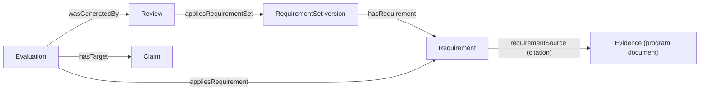

# Requirements, requirement sets and reviews

This document describes [`Requirement.yaml`](../schema/src/Requirement.yaml): the records a program
publishes to say what it requires, and the review that applies them. They replace the JSON rule
documents first defined for WP5-01 ([regen-network/claims#30](https://github.com/regen-network/claims/issues/30)),
so that requirements are RDF records like the claims and evaluations that reference them.
Evaluations already name requirements with `appliesRequirement` and requirement set versions with
`appliesRequirementSet` ([evaluation-and-evidence.md](evaluation-and-evidence.md#shared-terms)); these
are the records those IRIs identify.

## How the types relate

| Type | Made by | Used by | IRI |
|---|---|---|---|
| `Requirement` (abstract), `GenericRequirement` | A program maintainer | Evaluators, which apply it; authoring tools, which show what evidence it expects | Computed from its content, as a Claim's is |
| `RequirementSet` | A program maintainer | Reviews, which apply exact versions of it | Computed from its content |
| `Review` | Whoever runs the process: a registry, a funder, an auditor | Evaluations made in it | Minted, as for every Activity |

## Requirement

A requirement states one thing a program requires, as one exact version:

| Field | RDF term | Card. | Meaning |
|---|---|---|---|
| `identifier` | `schema:identifier` | 1 | The program's code, such as `EXAMPLE-REGISTRATION-CP-1`, which reviewers and findings use. A revised version keeps it. |
| `requirementStatement` | `rfs:requirementStatement` ⊑ `schema:description` | 1 | The requirement in plain language. |
| `requirementSource` | `rfs:requirementSource` | 0..1 | Where the program states it: an `EvidenceCitation` of the exact program document, with selectors for the passage. Absent when the statement is itself the program's text. |
| `assessmentScope` | `rfs:assessmentScope` | 1 | What checking it establishes and what it leaves to another check or a person. |
| `acceptsEvidence` | `rfs:acceptsEvidence` | 0..*, set | The kinds of evidence a claimant is expected to cite, each a source type and an optional media type (`EvidenceKind`). Guidance for authoring; evaluation does not use it. |
| `requirementCheck` | `rfs:requirementCheck` | 0..1 | The executable check, below, with its `queryLanguage`. Without one, a person checks the requirement. |
| `wasRevisionOf` | `prov:wasRevisionOf` | 0..1 | The earlier version this one revises. |

**Identity.** A requirement's IRI is computed from its content, as a Claim's is
([regen-network/claims#1](https://github.com/regen-network/claims/issues/1)), so the record does not
contain it. Its `identifier` field is the program's code, not its IRI. A change to any field is a new
version. An unchanged requirement keeps its IRI in every requirement set version that lists it:
when a new version of a checklist changes only one requirement, every other requirement is the same
record in both versions, and results about it stay about the same requirement. So a requirement alone does not say which set version an evaluation applied;
the evaluation's Review, or its own `appliesRequirementSet`, says that.

**Extension point.** `Requirement` is abstract and its generated shape is open, as for `Claim` and
`Evaluation`: a program can define its own kind of requirement with fields of its own, and the base
shape checks the shared fields. `GenericRequirement` is the closed class for a requirement with the
shared fields only. The policy for public extension points is
[regen-network/regen-data-standards#106](https://github.com/regen-network/regen-data-standards/issues/106).

### The executable check

A `RequirementCheck` holds queries that each answer true or false, over one exact Claim version
named by the variable `?_claim_iri`, run on a fixed set of records selected for that version. Its
`queryLanguage` (required) names, as an IRI, the exact language the queries are written in, with any
extension they rely on. The queries decide in this order:

1. `evidenceAvailableQuery` false: the evidence the check needs is missing.
2. `needsHumanReviewQuery`, if given, true: the check cannot decide and a person must, for example
   because the stated period may include renewal periods that need a separate decision.
3. Otherwise `satisfiedQuery`: true means satisfied, false means not met.

A query that fails, or an input record that cannot be read, is an error of the evaluation, never a
false answer.

**Query language.** An evaluator that does not support a check's `queryLanguage` does not run the
check and reports an error. The value is an IRI rather than a closed list, so a check written for
another language or tool needs no schema change, only an IRI that names it precisely.
`QueryLanguageType` lists the recommended values; today there is one:

- `rfs:Sparql11Sep0002`: SPARQL 1.1 ASK queries, with the dates, times and durations of
  [SPARQL-dev SEP-0002](https://github.com/w3c/sparql-dev/blob/39da1d22059e4b637aa8fa1a7142173a0d4c30cf/SEP/SEP-0002/sep-0002.md), "Add Support Durations, Dates, and Times", as SPARQL 1.1's
  [section 17.3.1](https://www.w3.org/TR/sparql11-query/#operatorExtensibility) allows. SEP-0002 adds
  the `xsd:date`, `xsd:time` and duration datatypes with their XPath comparison and arithmetic
  operators, such as comparing two `xsd:date` values (`op:date-less-than`) or adding an
  `xsd:yearMonthDuration` to an `xsd:date` (`op:add-yearMonthDuration-to-date`), and functions such as
  `YEAR` on an `xsd:date`. The example's check uses them to find a ten-year period. Neither SPARQL 1.1
  nor the SPARQL 1.2 Working Draft defines them. An engine that lacks one does not fail the query: the
  `FILTER` using it is false, and a ten-year period would be reported not met. So an evaluator for
  this language supports all of SEP-0002; Oxigraph does, with its `sep-0002` feature.

This schema does not run the queries.

Each outcome has an explanation in the check. A human-review query requires its
explanation, and an explanation for human review requires the query (a LinkML rule, enforced by the
generated JSON Schema only).

Which SPARQL a check may use, such as no `SERVICE` and no `NOW()`, is checked by the service that
publishes the set, not by this schema.

## RequirementSet

One exact version of a set of requirements, such as version 2026-05 of a registration checklist:

| Field | RDF term | Card. | Meaning |
|---|---|---|---|
| `identifier` | `schema:identifier` | 1 | The program's code for the set, such as `EXAMPLE-REGISTRATION`, shared by all its versions. Not unique across programs. |
| `version` | `schema:version` | 1 | The program's label for this version. Labels have no implied order. |
| `name` | `schema:name` | 1 | Title. |
| `hasRequirement` | `rfs:hasRequirement` | 1..*, set | The requirement versions in this version, by IRI. |
| `governedBy` | `rfs:governedBy` | 0..*, set | The program documents the set implements, such as a credit class version. |
| `wasRevisionOf` | `prov:wasRevisionOf` | 0..1 | The earlier version this one revises. |

Its IRI is computed from its content, so adding, removing or revising a requirement makes a new
version. The versions of a set are found by following `wasRevisionOf`, not by the code, which another
program could reuse. Whether a version is approved for use, and which version replaced it, change
over time and are kept by the service that manages the set.

## Review

A `Review` is an `Activity` that applies requirement set versions: a project's registration review,
a funder's vetting round covering several projects, an audit. It names its versions with
`appliesRequirementSet` (required) and may have a start and an end date. It opens when the work it
assesses is submitted for review, such as the claims of a project's application; the reviewers' own
work may start later. Its versions are fixed when it opens. An evaluation made in it names it with
`wasGeneratedBy`, and so applies its versions, even after a newer version of the set replaces them. An assessment made outside any process, such as a one-off screening, needs no Review:
its evaluation names the set version with `appliesRequirementSet`.

## Examples

| Example | Shows |
|---|---|
| [`generic-requirement.jsonld`](../schema/examples/generic-requirement.jsonld) | The crediting term of the public C06 credit class, citing page 7 of its version 1.5.2, with an executable check, including a query that sends a period of twenty years or more, which may include a renewal, to a person |
| [`requirement-set.jsonld`](../schema/examples/requirement-set.jsonld) | A version of an invented registration checklist implementing that credit class, listing that requirement |
| [`review.jsonld`](../schema/examples/review.jsonld) | The registration review of project P-001, applying that version |
| [`registry-requirement-evaluation.jsonld`](../schema/examples/registry-requirement-evaluation.jsonld) | An evaluation made in that review (`wasGeneratedBy`), applying the requirement |
| `requirement.SCHEMA-INVALID-*.yaml`, `requirement-set.SCHEMA-INVALID-*.yaml`, `review.SCHEMA-INVALID-*.yaml` | A check without its query language, a human-review query without its explanation and the reverse, a set without requirements, a review without a requirement set |

The requirement cites the public C06 credit class document; its code, the checklist, the review and
the project are invented, and the IRIs computed from content are labelled placeholders.
